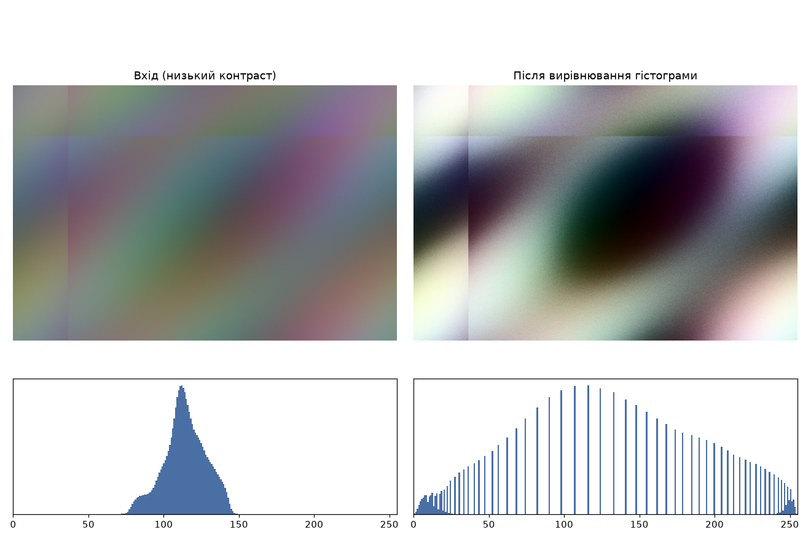
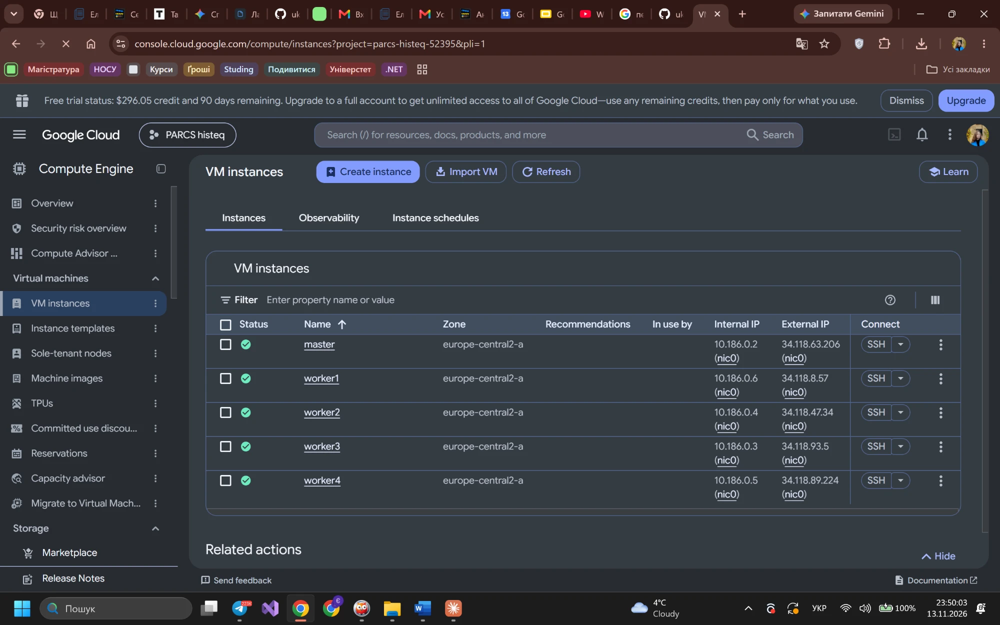
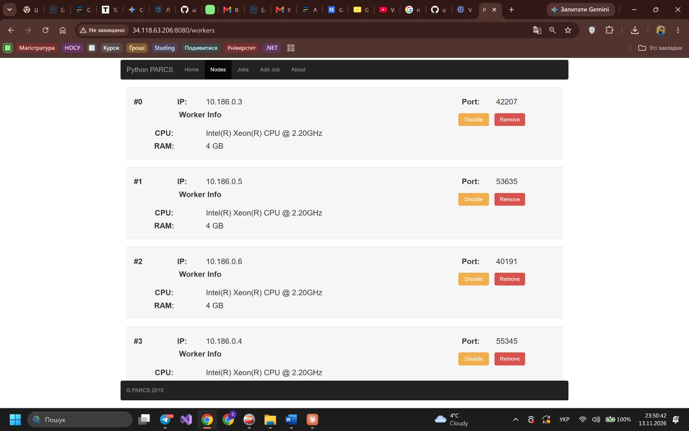
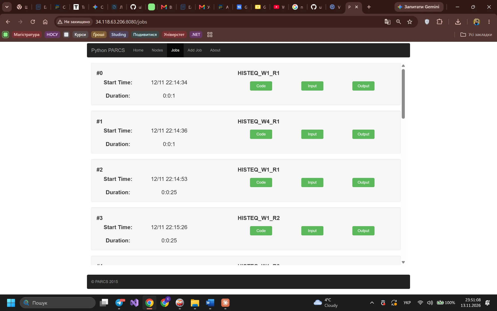
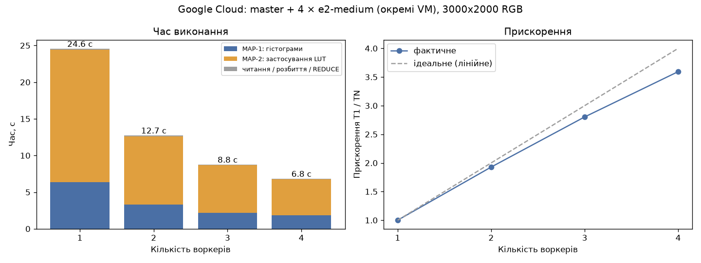
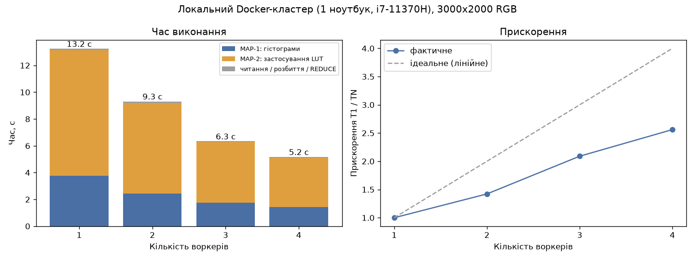

# Паралельне вирівнювання гістограми зображення на PARCS-Python

Лабораторна робота 1, курс «Хмарні обчислення», ТТП-42, КНУ, 2026.
Тема **5.2 — Паралельна обробка гістограм**: підрахунок і вирівнювання гістограми
зображення для покращення контрасту. Платформа: **PARCS-Python**, хмара: **Google Cloud (Compute Engine)**.



---

## 1. Опис алгоритму

**Вирівнювання гістограми** перерозподіляє рівні яскравості так, щоб вони рівномірно
займали весь діапазон 0…255. Для темних / «блідих» зображень це різко піднімає контраст.

Послідовний алгоритм для зображення з `T` пікселів:

1. гістограма `h[v]` — скільки пікселів мають яскравість `v`;
2. кумулятивна функція `cdf[v] = h[0] + … + h[v]`;
3. таблиця перетворення `lut[v] = round((cdf[v] − cdf_min) / (T − cdf_min) · 255)`;
4. кожен піксель `p → lut[p]`.

Для кольорових зображень (RGB) пікселі переводяться в YCbCr, вирівнюється лише яскравість Y,
кольоровість Cb/Cr зберігається (інакше кольори «пливуть»).

**Паралельна схема (map → reduce → map):**

```
              ┌─ worker 1: hist(strip 1) ─┐                       ┌─ worker 1: lut(strip 1) ─┐
master: split ├─ worker 2: hist(strip 2) ─┤→ master: Σ hist → CDF ├─ worker 2: lut(strip 2) ─┤→ master: concat
 N смуг       ├─ …                        │   → LUT (256 чисел)   ├─ …                       │
              └─ worker N: hist(strip N) ─┘                       └─ worker N: lut(strip N) ─┘
```

* Зображення ділиться на **N горизонтальних смуг** (N = кількість воркерів).
* **MAP-1:** кожен воркер рахує локальну гістограму своєї смуги — повертає лише 256 чисел.
* **REDUCE:** master сумує гістограми (гістограма — адитивна, тож сума локальних = глобальна),
  будує CDF і LUT. Це O(256) — миттєво.
* **MAP-2:** master розсилає LUT (256 чисел), воркери перетворюють свої смуги.
* Master склеює смуги у вихідне зображення.

Обидві фази MAP — O(T/N) на воркер, тому теоретично час ≈ T/N. Результат **не залежить від N**
(перевірено побайтово для N = 1…4 та звірено з еталонною реалізацією на numpy).

## 2. Демонстрація коду

Код: [`solver/histeq_solver.py`](solver/histeq_solver.py) — один файл, який завантажується в PARCS
як *Solution File*. Ключові частини:

```python
def solve(self):                                   # виконується на master
    magic, width, height, pixels = self.read_input()
    strips = self.split(pixels, width * channels, height, n)
    wire = [_to_wire(bytes(s)) for s in strips]
    hists = self.parallel_call('local_histogram', [(w, channels) for w in wire])      # MAP-1
    lut = Solver.build_lut(Solver.merge_histograms(hists))                            # REDUCE
    results = self.parallel_call('apply_lut', [(w, channels, lut) for w in wire])     # MAP-2
    ...

@staticmethod
@expose                                            # виконується на worker (Pyro4 RPC)
def local_histogram(strip_wire, channels):
    data = _from_wire(strip_wire)
    hist = [0] * 256
    for p in data:
        hist[p] += 1
    return hist
```

* `parallel_call` викликає метод на всіх воркерах **одночасно** (по потоку на воркер) і чекає всіх —
  інакше послідовні RPC-виклики виконувались би по черзі й паралелізму б не було.
* Смуги передаються як один base64-рядок — Pyro4/serpent серіалізує його значно швидше,
  ніж список з мільйонів чисел.
* Час кожної фази solver записує в заголовок вихідного PPM-файлу (`# t_total=…`),
  бо веб-інтерфейс PARCS показує тривалість лише в цілих секундах.

Допоміжні скрипти (`tools/`):

| Скрипт | Призначення |
|---|---|
| `make_input.py` | будь-яке фото (або синтетика) → низькоконтрастний PGM/PPM для PARCS |
| `local_run.py` | прогін solver без кластера (послідовна перевірка) |
| `local_cluster.sh` | локальний PARCS-кластер у Docker (master + N workers) |
| `benchmark.py` | автоматичний прогін на кластері через HTTP API PARCS для N = 1…4 |
| `plot_results.py` | таблиця + графік з CSV |
| `show_result.py` | вхід/вихід + гістограми «до/після» |

## 3. Build-проблеми та їх вирішення

| Проблема | Як проявилась | Рішення |
|---|---|---|
| PARCS-Python написаний під **Python 2.7** (образ 2018 р.: Python 2.7.13, Pyro4 4.74) | код PARCS використовує `Pyro4.async(...)` — у Python ≥ 3.7 `async` зарезервоване слово, вузол не запускається | використовувати готовий образ `hummer12007/parcs-node`; solver написаний сумісно з Python 2.7 і 3.x (без f-strings, `//`, `range`, `bytes`/`bytearray`) |
| Образ **не збирається з вихідників** (`docker build`) | `apt-get update` → `404 Not Found` (Debian stretch переїхав в archive.debian.org); на базі `python:2.7-slim` — `pip` падає з `CERTIFICATE_VERIFY_FAILED` (старий OpenSSL/pip проти сучасного сертифіката pypi.org) | не перезбирати — брати готовий образ з Docker Hub (як і в методичці) |
| В образі немає **numpy / Pillow** | `import numpy` у solver → помилка задачі | вхід/вихід у форматі бінарного **PGM/PPM** (заголовок + сирі байти), розбір на чистому Python |
| Тривалість задачі у веб-UI — **цілі секунди** (`timedelta.seconds`) | для невеликих зображень усі прогони «0:0:1» | власні таймери фаз у solver, запис у заголовок вихідного файлу |
| `gcloud compute instances create-with-container` з методички **вимкнена Google** | `ERROR: … The option to deploy a container during VM instance creation that relies on a container startup agent is discontinued` | VM на **Container-Optimized OS** + startup-скрипт `docker run --net=host … hummer12007/parcs-node` ([`gcp/`](gcp)) |
| На COS-VM веб-інтерфейс і воркери недоступні, хоча контейнер працює | `http://<master>:8080` не відповідає; у serial-лозі `startup-script exit status 0` | у COS свій фаєрвол iptables (пропускає лише SSH) → у startup-скрипті `iptables -A INPUT -p tcp --dport 8080 -j ACCEPT` і `-s 10.128.0.0/9 -j ACCEPT` |
| `gcloud auth login` падає | `SSLError … CERTIFICATE_VERIFY_FAILED: unable to get local issuer certificate` — Avast Web Shield перехоплює HTTPS і підписує сертифікати своїм коренем | додати корінь Avast (з Windows-сховища) до CA-бандла: `gcloud config set core/custom_ca_certs_file …` (перевірка TLS лишається увімкненою) |
| Docker Desktop (Windows) не стартує при локальному тестуванні | `removing stale socket … userAnalyticsOtlpHttp.sock: The file cannot be accessed by the system` | закрити Docker, `wsl --shutdown`, перейменувати `%LOCALAPPDATA%\Docker\run`, запустити знову |

## 4. Гайд з налаштування хмари

Повний покроковий гайд з командами: **[docs/GCP_RUN_GUIDE.md](docs/GCP_RUN_GUIDE.md)**. Коротко:

```powershell
gcloud projects create $PROJECT ; gcloud config set project $PROJECT
gcloud services enable compute.googleapis.com
gcloud config set compute/zone europe-central2-a
gcloud compute firewall-rules create parcs-web --allow=tcp:8080 --source-ranges="$MYIP/32"
gcloud compute instances create master --machine-type=e2-medium --image-family=cos-stable --image-project=cos-cloud --metadata-from-file=startup-script=gcp/startup-master.sh
gcloud compute instances create worker1 worker2 worker3 worker4 --machine-type=e2-medium --image-family=cos-stable --image-project=cos-cloud --metadata=parcs-master-ip=$MASTER_IP --metadata-from-file=startup-script=gcp/startup-worker.sh
# http://<MASTER_EXTERNAL_IP>:8080 → Add Job (solver/histeq_solver.py + data/input_rgb.txt)
python tools/benchmark.py --master http://<MASTER_EXTERNAL_IP>:8080 --input data/input_rgb.txt --workers 1 2 3 4 --repeat 3 --csv results/gcp.csv
```

## 5. Демонстрація кластера в Google Cloud

**VM у Compute Engine: master + worker1…worker4**



**PARCS → Nodes: 4 зареєстровані воркери**



**PARCS → Jobs: виконані задачі для N = 1, 2, 3, 4 воркерів**



## 6. Результати

Вхід: синтетичне RGB-зображення **3000×2000** (18 МБ), `python tools/make_input.py --out data/input_rgb.txt --mode RGB --size 3000x2000`.

### Google Cloud (master + 4 × e2-medium, europe-central2-a, 13.11.2026)

Кожен вузол — окрема VM (Intel Xeon 2.20 GHz, 4 GB RAM). Список VM: [`results/gcp_instances.txt`](results/gcp_instances.txt).
Кількість воркерів змінювалась кнопками Enable/Disable PARCS; по 3 прогони на кожне N, у таблиці — середнє.

| Воркери | Прогонів | Гістограма (MAP-1), с | LUT (REDUCE), с | Застосування (MAP-2), с | Загальний час, с | Прискорення | Ефективність |
|---:|---:|---:|---:|---:|---:|---:|---:|
| 1 | 3 | 6.36 | 0.000 | 18.05 | **24.56** | 1.00× | 100% |
| 2 | 3 | 3.30 | 0.000 | 9.34 | **12.74** | 1.93× | 96% |
| 3 | 3 | 2.20 | 0.000 | 6.49 | **8.76** | 2.80× | 93% |
| 4 | 3 | 1.82 | 0.000 | 4.94 | **6.83** | 3.59× | 90% |



Вихідні зображення для N = 1…4 побайтово однакові.

### Локальний Docker-кластер (для порівняння; усі вузли на одному ноутбуці i7-11370H, 4 ядра)

| Воркери | Прогонів | Гістограма (MAP-1), с | LUT (REDUCE), с | Застосування (MAP-2), с | Загальний час, с | Прискорення | Ефективність |
|---:|---:|---:|---:|---:|---:|---:|---:|
| 1 | 2 | 3.77 | 0.000 | 9.37 | **13.24** | 1.00× | 100% |
| 2 | 2 | 2.44 | 0.000 | 6.77 | **9.31** | 1.42× | 71% |
| 3 | 2 | 1.76 | 0.001 | 4.51 | **6.34** | 2.09× | 70% |
| 4 | 2 | 1.42 | 0.000 | 3.69 | **5.17** | 2.56× | 64% |



**Спостереження.**
* У хмарі час спадає майже лінійно: 24.6 с → 6.8 с на 4 воркерах (прискорення 3.59×, ефективність 90%).
  Фаза REDUCE (256 чисел) — нехтовно мала.
* Локально прискорення гірше (2.56×): усі 5 контейнерів ділять 4 ядра одного ноутбука,
  тоді як у GCP кожен воркер має власну VM.
* Прискорення нижче лінійного через послідовну частину на master (читання файлу, розбиття,
  base64-кодування та склеювання смуг) і передачу даних по мережі (закон Амдала).
* Для **сірого** зображення 4000×3000 (`--mode L`) обчислень на піксель замало: передача
  даних з'їдає виграш (2.6 с → 1.7 с на 4 воркерах). Кольорове зображення (YCbCr-перетворення
  на кожен піксель) має значно краще співвідношення обчислень до передачі.

## 7. GitHub

> TODO: посилання на репозиторій.

## Структура

```
solver/histeq_solver.py   — PARCS solution file (master + worker код)
tools/                    — підготовка даних, локальний запуск, бенчмарк, графіки
docs/GCP_RUN_GUIDE.md     — гайд з розгортання в Google Cloud
gcp/                      — startup-скрипти master/worker для VM на Container-Optimized OS
results/                  — таблиці, графіки, зображення до/після
data/                     — вхідні файли (генеруються make_input.py, у git не зберігаються)
```
